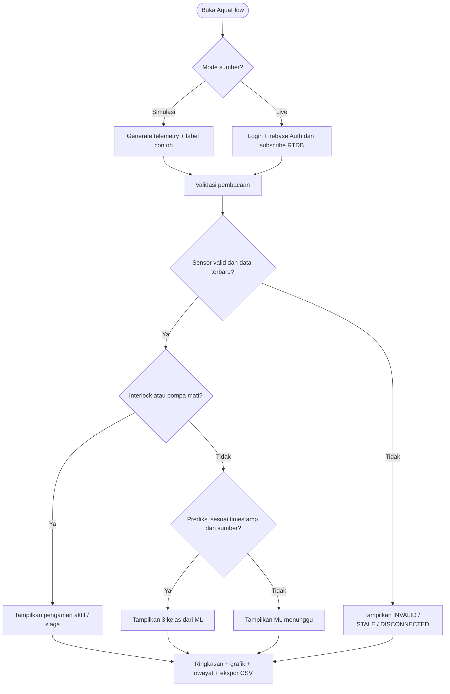
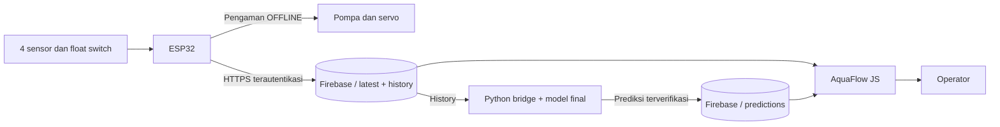
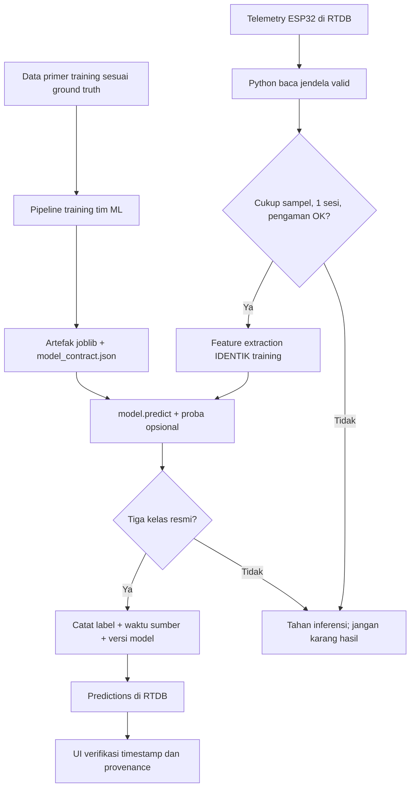

# Alur integrasi AquaFlow — Konsep untuk ketiga tim

## Diagram A — Tampilan dashboard

## Diagram B — Antarplatform

## Diagram C — Inferensi model

## Paths Firebase target (usulan, tidak tersedia di proyek Firebase nyata)

| Path | Penulis | Pembaca | Fungsi |
|---|---|---|---|
| `devices/saluran-01/latest` | ESP32/gateway tepercaya | Dashboard, Python | Pembacaan terbaru |
| `devices/saluran-01/history/{push-id}` | ESP32/gateway | Dashboard, Python | Raw telemetry tersimpan |
| `devices/saluran-01/predictions/latest` | Python Admin SDK | Dashboard | Prediksi terbaru ML |
| `devices/saluran-01/predictions/history/{push-id}` | Python Admin SDK | Dashboard | Log inferensi model |

Tidak ada remote control pompa/servo dari browser pada konsep ini. Keputusan fitur kontrol baru dapat dilakukan setelah tim Hardware menyetujui kendali lokal, autentikasi, logging, dan interlock keselamatan.
