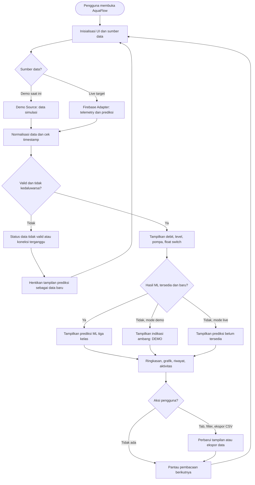
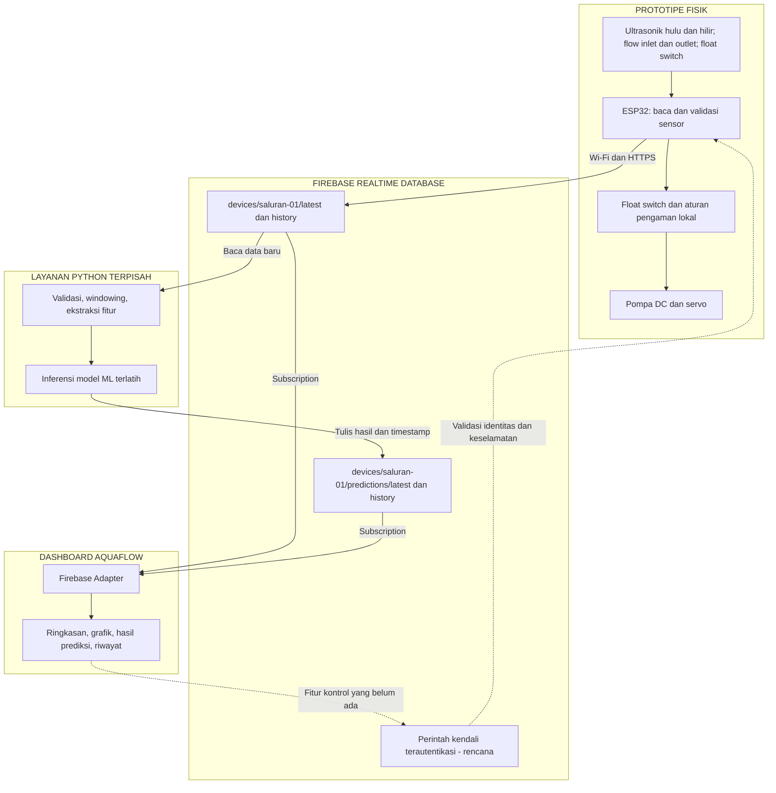
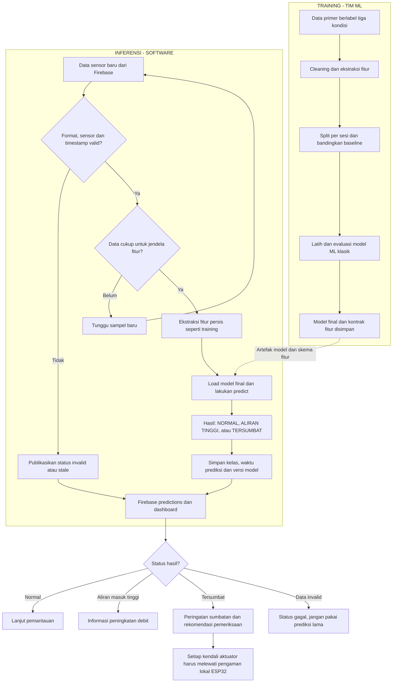

# AquaFlow — Flowchart Software dan Integrasi ML

**Proyek:** Rancang Bangun Sistem Deteksi Sumbatan pada Miniatur Saluran Air  
**Basis:** Panduan UAS IoT × ML; proposal IoT; simulasi 3D HTML; AquaFlow dashboard dari Aan; proposal ML poin 5–8.  
**Konvensi:** *Saat ini* = sudah ada dalam source dashboard; *target integrasi* = alur yang akan dibangun. Fokus utama 3 kelas sumbatan, bukan kelas kebocoran pada draf ML berbeda.

## A. Flowchart alur dashboard AquaFlow

## B. Flowchart integrasi antarplatform

## C. Flowchart integrasi ML: training ke inferensi real-time

## Penyesuaian implementasi yang perlu disepakati

1. **Kelas ML resmi:** NORMAL, ALIRAN_MASUK_TINGGI, TERSUMBAT. Draf ML kebocoran tidak cocok dengan proposal deteksi sumbatan; selaraskan bersama tim ML sebelum training.
2. **Fitur saat ini:** `config.source = 'demo'`, Firebase adapter masih placeholder. Dashboard memakai peraturan ambang (`flowLossPercent: 20`, `heightGapCm: 1.5`) dan **belum** menampilkan inferensi ML.
3. **Kontrak data sekarang:** `timestamp` (Unix ms), `inletLpm`, `outletLpm`, `upstreamCm`, `downstreamCm`, `pumpOn`, `floatSafe`. Pertahankan format data tersebut dan tambahkan jalur *predictions* terpisah (usulan) agar data sensor dan hasil Python tidak saling menimpa.
4. **Interaktivitas:** tab Ringkasan/Riwayat Data/Sistem Alat, grafik, ekspor CSV sudah ada di mode demo. Fitur kontrol fisik pompa/servo belum ada dalam source AquaFlow dan sebaiknya dianggap rencana.
5. **Ketahanan:** saat koneksi putus, sensor gagal, atau data kedaluwarsa, tampilkan status jelas dan jangan menampilkan prediksi lama seolah baru. Interlock pompa wajib dijalankan lokal pada ESP32, tidak menunggu Firebase/Python.
6. **Model final:** proposal IoT menyebut Random Forest; model final harus mengikuti hasil evaluasi tim ML. Desain windowing (10 detik dan hop 5 detik) dalam draf ML yang membahas kebocoran **belum otomatis berlaku** untuk proyek sumbatan.
7. **Komponen:** proposal IoT menggunakan servo pengatur pintu sumbatan, sedangkan demo HTML/dashboard menggambarkan sekat/soket yang diubah manual. Samakan dengan keputusan tim hardware agar dokumentasi tidak berbeda.
